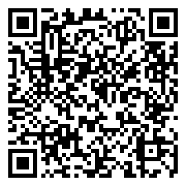

# MailVault — local-only email storage / poczta tylko lokalnie

```
     /\
    /  \
   /    \
  /______\
  |\    /|
  | \__/ |
  |______|
```

Thunderbird add-on (115 ESR+) that keeps mail **only locally**. For each IMAP mailbox `X`, it copies every message into a local folder, verifies each copy, and only then moves the server original to the trash. The local folder is the account `X - lokalne` if it exists, otherwise the folder `X` in Local Folders, created on the first cycle.

[Polski opis niżej](#polski)

## How it works

The add-on runs a **cycle** for each selected mailbox in turn. Each step is a checkbox, so you choose which ones run:

1. **Rebuild local indexes.** Opens local folders one by one. Folders created outside Thunderbird stay invisible to the add-on until this is done.
2. **Refresh server folders.** Opens every folder of the mailbox, so Thunderbird fetches the current message list from the server. Without it, folders not opened recently show an old state.
3. **Copy server → local.** Each copy is confirmed by its Message-ID. Stars, tags and read state carry over. Messages go here:

   | Server folder | Local folder |
   |---|---|
   | Sent | `Sent` |
   | Drafts | `Drafts` |
   | Templates | `Drafts/Szablony` |
   | Archive, and Gmail messages only in All Mail | `Archives` |
   | Everything else (Inbox, Spam, other folders, Trash) | `Inbox/<sender address>` |

4. **Sort the local Inbox** into per-sender subfolders.
5. **Remove local duplicates.** A duplicate is the same Message-ID twice in one folder; the extra copy goes to the local Trash.
6. **Move to server trash** every message that has a confirmed local copy. This includes Gmail *All Mail*, because on Gmail a plain delete only archives.
7. **Empty trash.** On the server, only messages that have a local copy are deleted. The local Trash is emptied completely.

**Preview mode** writes the log and the index and changes nothing. It is on by default.

**Server ↔ local index.** After each cycle, the add-on shows a table for every mailbox: unique messages on the server, how many have a local copy, how many are missing, and how many are starred, tagged and archived.

**Automatic runs:** after Thunderbird starts, every N minutes, or both.

## Safety

- Steps 6 and 7 delete data. They are irreversible, and the page asks for confirmation before running them.
- Test on a copy of your profile first:
  ```
  cp -a ~/.thunderbird/<profile> ~/.thunderbird/test-profile
  thunderbird --profile ~/.thunderbird/test-profile --no-remote
  ```
- Nothing is sent anywhere: no network calls, no telemetry. The log masks addresses (`a***@domain`) and never records subjects.

## Requirements

- Thunderbird 115 or newer.
- Nothing to set up. Optionally, a separate local account named exactly `X - lokalne` for IMAP account `X`; without it the add-on uses `Local Folders/X`.

## Install

Download the latest `.xpi` from Releases, then in Thunderbird go to *Add-ons and Themes → gear icon → Install Add-on From File*.

## Build

```
zip -r mailvault.xpi manifest.json background.js options.html options.js _locales
```

## Permissions

| Permission | Used for |
|---|---|
| `accountsRead`, `accountsFolders` | Listing accounts and folders, creating sender folders |
| `messagesRead`, `messagesMove`, `messagesDelete` | Copying, moving, and deleting from trash |
| `messagesUpdate`, `messagesTags` | Copying stars, tags and read state to local copies |
| `storage` | Settings, log, index |

## Support

If this project saves you time, you can support its development:

- **GitHub Sponsors:** https://github.com/sponsors/shimomurakei
- **Monero (XMR):**

```
87SX973rjbP1E9FrrNXnsLHhMzhLfmCFyALnFrtQVVtgEuQyoxXhmbUE6woR3R9yyQFKM7M2SDvJ82cWJLcfWK6GPF4fzux
```



## License

MailVault — Copyright (C) 2026 .kei
https://github.com/shimomurakei/mailvault

Licensed under the GNU General Public License v3.0 or later (GPL-3.0-or-later); full text in `LICENSE`.

Additional term under GPLv3 section 7(b): any modified or redistributed version must preserve this author attribution, including the link above, in its README and on its settings page.

Request (not a license condition): if you build on this project, please let me know by opening an issue in the repository above, so we can cooperate.

---

## Polski

Dodatek do Thunderbirda (115 ESR+). Dla każdej skrzynki IMAP `X` kopiuje wszystkie wiadomości do konta lokalnego `X - lokalne`, a jeśli go nie ma, do folderu `X` w Folderach lokalnych, i potwierdza każdą kopię. Dopiero potem przenosi oryginał na serwerze do kosza.

**Cykl** działa na każdej wybranej skrzynce osobno. Każdy krok można włączyć lub wyłączyć:

1. Odbudowa indeksów lokalnych.
2. Odświeżenie folderów serwera: Thunderbird pobiera aktualną listę wiadomości.
3. Kopia z serwera do lokalnych, z potwierdzeniem. Przenosi gwiazdki, etykiety i stan przeczytania.
4. Sortowanie lokalnego Odebrane według nadawców.
5. Usunięcie duplikatów lokalnych.
6. Przeniesienie do kosza serwera wszystkiego, co ma kopię lokalną, także z Gmaila (Wszystkie, Odebrane, Spam).
7. Opróżnienie koszy. Z kosza serwera znikają tylko wiadomości z kopią lokalną, lokalny Kosz jest czyszczony w całości.

**Podgląd** tylko zapisuje dziennik i indeks, niczego nie zmienia. Jest domyślnie włączony.

**Indeks serwer ↔ lokalnie** pokazuje dla każdej skrzynki, ile wiadomości jest na serwerze, ile ma kopię lokalną, ile brakuje, oraz ile ma gwiazdkę, etykiety i status archiwalny.

**Uruchamianie automatyczne:** po starcie Thunderbirda, co N minut albo oba naraz.

**Kroki 6 i 7 usuwają dane i są nieodwracalne.** Najpierw sprawdź dodatek na kopii profilu. Dziennik maskuje adresy i nie zapisuje tematów. Dodatek nie wysyła żadnych danych na zewnątrz.

Instalacja: *Dodatki i motywy → koło zębate → Zainstaluj dodatek z pliku*.

**Licencja:** GPL-3.0-or-later (tekst w `LICENSE`). Każda przeróbka musi zachować informację o autorze z linkiem https://github.com/shimomurakei/mailvault. Prośba, nie warunek licencji: jeśli budujesz na tym projekcie, daj znać w zgłoszeniu (issue) w repozytorium, to możemy współpracować.

**Wsparcie:** GitHub Sponsors https://github.com/sponsors/shimomurakei albo Monero (XMR): `87SX973rjbP1E9FrrNXnsLHhMzhLfmCFyALnFrtQVVtgEuQyoxXhmbUE6woR3R9yyQFKM7M2SDvJ82cWJLcfWK6GPF4fzux` (kod QR w sekcji Support).
